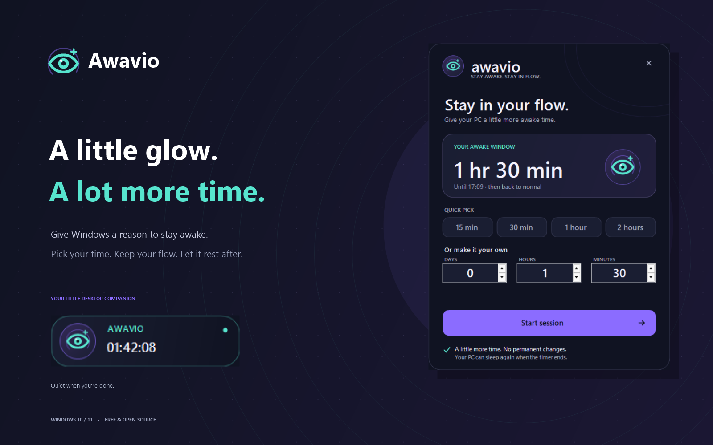

# Awavio

**Akışını kesme.**

<p align="center">
  
</p>

[Windows için indir](https://github.com/PbyLoyth/Awavio/releases/latest) · [English](../README.md) · [Ayrıntılı kullanım rehberi](USAGE.md)

Awavio, bilgisayarını seçtiğin süre boyunca uyanık tutar. Süre bitince Windows'un normal uyku ayarları yeniden geçerli olur. Görev çubuğunun üzerinde duran küçük göz, kalan süreyi gösterir: tıkla ve başlat, yeniden tıkla ve süre ekle, basılı tut ve bitir.

Uzun indirmeler, sunumlar, render işleri ve bilgisayarının erişilebilir kalmasını istediğin zamanlar için.

## Görünüm

<p align="center">
  
</p>

| Hazır | Oturum açık |
| :---: | :---: |
|  |  |

*Bu önizlemeler uygulamanın gerçek Windows arayüzünden üretildi. Görseldeki geri sayım örnektir.*

## Neler yapar?

- Gün, saat ve dakika girerek veya hazır sürelerden birini seçerek oturum başlatırsın.
- Küçük widget'tan kalan süreyi görür, süre ekler, oturumu bitirir ve widget'ı sürükleyebilirsin.
- Kapak kapalıyken uyanık tutma seçeneği açık olduğunda, etkin güç planının prizde ve pilde kapak ayarını oturum boyunca **Hiçbir şey yapma** olarak değiştirir.
- Oturum sonunda eski kapak ayarlarını geri getirir. Oturum sırasında **Hiçbir şey yapma** dışında bir değer seçtiysen bu seçimini korur.
- Pilde çalışırken şarj seçtiğin eşiğin altına inince oturumu bitirir. Varsayılan eşik **%10**.
- İstersen ekranı açık tutar. Bu seçenek kapalıyken ekran kapanabilir, bilgisayar uyanık kalır.
- Değişikliği uygulamadan önce kurtarma kaydını diske yazar. Kurulu sürüm, oturum açılışında ve kullanıcı oturumu açıkken her beş dakikada bir geri yüklemeyi dener.
- İstersen Windows açıldığında otomatik başlar.

## Kurulum

**Windows 10 veya 11, x64.** Hazır sürümü çalıştırmak için .NET kurulumu ya da yönetici hakkı gerekmez. İlk sürüm ARM64 desteklemiyor.

1. [Son sürüm sayfasından](https://github.com/PbyLoyth/Awavio/releases/latest) **Awavio-0.1.0-win-x64.zip** dosyasını indir.
2. ZIP'in tamamını bir klasöre çıkar.
3. **Install.cmd** dosyasına çift tıkla.
4. Başlat menüsünden **Awavio**'yu aç.

Sürüm kod imzası taşımadığı için Windows bir SmartScreen bildirimi gösterebilir.

Windows ile otomatik başlamasını kurulum sırasında etkinleştirmek için, çıkardığın klasörde PowerShell açıp çalıştır:

```powershell
powershell -NoProfile -ExecutionPolicy Bypass -File .\install.ps1 -PublishedDirectory . -StartWithWindows
```

Kurulum uygulamayı `%LOCALAPPDATA%\Programs\Awavio` içine kopyalar, Başlat menüsüne kısayol ekler ve **Awavio recovery** zamanlanmış görevini oluşturur.

### Kurmadan kullanmak

Çıkardığın klasörden **Awavio.exe** dosyasını açabilirsin. Ayarlar yine `%LOCALAPPDATA%\Awavio` içinde tutulur. Kurmadan kullanımda kurtarma, uygulamayı yeniden açtığında çalışır; beş dakikalık kurtarma görevi yalnızca kurulumla eklenir.

## Kullanım

1. Saatin üzerindeki göz widget'ına tıkla.
2. Süreyi seç ve **Start session** düğmesine bas.
3. Oturum sırasında tıklarsan süre ekleme penceresi açılır.
4. Bitirmek için widget'a, bitirme çubuğu dolana kadar basılı tut. Sağ tık menüsündeki **End session** seçeneğini de kullanabilirsin.
5. Ekran, pil, kapak, widget ve başlangıç ayarları için widget'a veya saat yanındaki göze sağ tıkla.
6. Widget'ı sürükleyerek taşı. Konumu sonraki açılışta hatırlanır.
7. **Quit** ile çıkınca açık oturum bitirilir ve kapak ayarları geri yüklenir.

Saat yanındaki simge görünmüyorsa görev çubuğundaki **^** okunun altında olabilir. Uygulama arayüzü bu sürümde İngilizcedir.

Kapak kapalı kullanım için ilk denemeyi iki veya üç dakikalık bir oturumla yap. Oturum bitince eski kapak ayarının geri geldiğini kontrol et. Çalışan dizüstünü hava alan bir yüzeyde tut.

## Güncelleme ve kaldırma

Yeni sürümün ZIP'ini çıkarıp **Install.cmd** dosyasını çalıştır. Ayarların korunur.

Kaldırmak için çıkardığın sürümdeki **Uninstall.cmd** dosyasını çalıştır. Uygulama önce tamamlanmamış kapak değişikliğini geri almayı dener. Başaramazsa kurulumu silmeden durur.

Ayarları ve günlükleri de silmek için:

```powershell
powershell -NoProfile -ExecutionPolicy Bypass -File .\uninstall.ps1 -Purge
```

## Kaynaktan derleme

Yalnızca derlemek için **.NET 8 SDK veya sonrası** gerekir:

```powershell
git clone https://github.com/PbyLoyth/Awavio.git
cd Awavio
dotnet test .\tests\Awavio.Core.Tests
dotnet run --project .\src\Awavio.Windows
```

Kaynak koddan kurulum:

```powershell
powershell -NoProfile -ExecutionPolicy Bypass -File .\scripts\install.ps1
```

## Doğrulama ve kapsam

Gerçek testlerin kapsamı ve ortamı [VALIDATION.md](../VALIDATION.md) dosyasında. Fiziksel kapağı kapatma, pilin gerçekten boşalması ve gerçek oturum kapatma/kapanış davranışları ayrıca donanım üzerinde denenmelidir.

Awavio bilgisayarı zorla uyutmaz veya kapatmaz. Oturum bitince uyanık tutma isteğini bırakır; ardından Windows'un güç ayarları geçerlidir. Kuruluş tarafından yönetilen cihazlarda güç planı değişiklikleri kısıtlanmış olabilir.

Uygulama yerel çalışır; hesap, telemetri veya bulut servisi içermez. Bu Windows sürümünün odağı süre, kapak davranışı ve kurtarmadır; uygulama dondurma, ses kapatma, Docker, hotspot ve tmux özellikleri bulunmaz.

[Lisans: MIT](../LICENSE) · [Değişiklikler](../CHANGELOG.md) · [Katkıda bulun](../CONTRIBUTING.md) · [Sorun bildir](https://github.com/PbyLoyth/Awavio/issues/new)
