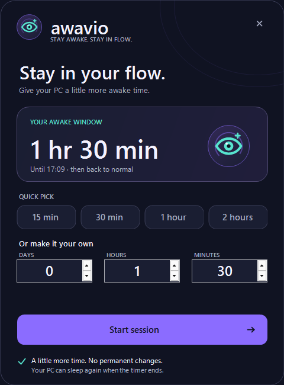

# Using Awavio

[Back to the project](../README.md) · [Türkçe hızlı başlangıç](README.tr.md)

Awavio has two entry points: the floating eye above the taskbar and the eye in the notification area. Both control the same session.

## Start a session

1. Click the widget or left-click the tray icon.
2. Select **15 min**, **30 min**, **1 hour** or **2 hours**, or enter **Days**, **Hours** and **Minutes**.
3. Select **Start session** or press **Enter**.

A duration must be at least one minute and at most 30 days. The last starting duration is remembered. The close button or **Escape** closes the window without starting a session.



## Add time or end early

Click the widget while a session is running, enter the additional duration, and select **Add time**.

To end early, press and hold the widget until the progress bar fills, then release. You can also right-click and choose **End session**. Dragging moves the widget instead of ending the session.

When the timer finishes, Awavio releases its system-awake request and restores the lid actions it changed. It does not immediately force sleep: Windows resumes following your normal power settings.

## Widget controls

| Action | Result |
| --- | --- |
| Click while idle | Start a session |
| Click while active | Add time |
| Press and hold while active | End the session |
| Right-click | Open the menu |
| Drag | Move the widget; its position is saved |

The widget stays above other windows without taking keyboard focus. You can hide it with **Show widget above the taskbar**; the tray icon remains available. **Move widget back above the clock** returns it to the default position.

| Idle | Active |
| :---: | :---: |
|  |  |

*Native UI previews; the timer value is illustrative.*

## Settings

Right-click the widget or notification-area icon. A check mark means the option is on.

| Menu item | Behavior |
| --- | --- |
| **Stay awake with the lid closed** | Temporarily sets the current power plan's plugged-in and battery lid actions to **Do nothing**. Default: on. Change this option between sessions. |
| **Keep the display on** | Also prevents the display from switching off. Default: off. Can be changed during a session. |
| **End on battery below** | Ends a session when unplugged and charge is below the selected percentage. Choices: Off, 5%, 10%, 15%, 20%, 30%. Default: 10%. |
| **Show widget above the taskbar** | Shows or hides the floating widget. Default: on. |
| **Move widget back above the clock** | Resets a visible widget's position. |
| **Start with Windows** | Starts the app at sign-in. Does not start an awake session by itself. |
| **Open log folder** | Opens the local diagnostic log directory. |
| **Quit** | Ends the session, restores changed lid actions, and exits. |

Awavio still holds a system-awake request with the closed-lid option off, but does not change the lid actions in that mode. Closing the lid can then trigger your normal Windows lid behavior.

Keeping the PC awake and keeping the display on are separate settings. With **Keep the display on** off, a dark screen does not mean the timed session has ended.

## Check closed-lid settings on your laptop

For your first use, start with a two- or three-minute session:

1. Note your current values in **Control Panel → Power Options → Choose what closing the lid does**.
2. With **Stay awake with the lid closed** enabled, start the session.
3. Check that the **On battery** and **Plugged in** lid values are **Do nothing**.
4. End the session or let its timer expire.
5. Check that your original values have returned.

You can also inspect the values from a terminal:

```powershell
powercfg /query SCHEME_CURRENT SUB_BUTTONS LIDACTION
```

The values are 0 for **Do nothing**, 1 for **Sleep**, 2 for **Hibernate**, and 3 for **Shut down**.

Awavio preserves a lid value you change away from **Do nothing** during its session. For example, if you change the plugged-in action to **Hibernate**, Awavio will leave that choice in place when the session ends. Selecting **Do nothing** again cannot be distinguished from Awavio's own setting.

Keep an awake laptop on a ventilated surface. Do not run a closed-lid awake session inside a bag.

## Recovery after an interrupted session

Awavio records the original lid actions on disk before it changes them. If the app exits unexpectedly:

- Windows releases the app's system-awake request.
- Lid actions are restored on the next launch.
- With an installed copy, the **Awavio recovery** scheduled task also checks at sign-in and every five minutes while you are signed in.

The recovery process leaves a live session alone. It does not resume an interrupted countdown.

If the widget shows **Needs attention**, a previous lid change could not be restored. Click the widget for recovery options, or right-click it:

- **Retry restoring the lid setting** attempts restoration again.
- **Forget it (keep the current lid setting)** discards the recovery record and leaves the current lid actions in place.

A pending recovery prevents a new session from starting until you resolve it. If restoration fails when you choose **Quit**, the app asks whether to quit anyway; the installed recovery task can retry later.

On a portable copy without the recovery task, reopen Awavio to retry recovery.

## Installation and updates

The recommended [release ZIP](https://github.com/PbyLoyth/Awavio/releases/latest) contains:

- **Awavio.exe** — the self-contained Windows x64 app.
- **Install.cmd / install.ps1** — the current-user installer.
- **Uninstall.cmd / uninstall.ps1** — the removal tools.
- License, attribution and quick-start information.

Extract the ZIP before running **Install.cmd**. No .NET installation or administrator rights are needed for a release build.

The installer adds a Start menu shortcut, places the executable in `%LOCALAPPDATA%\Programs\Awavio`, and registers the recovery task. Windows startup is optional.

To update, run the new release's installer. It stops a running installed copy and checks recovery before replacing its executable. Stop your current session first if you want to finish it normally. Settings and logs remain in place.

A portable copy can be updated by quitting it and replacing its executable.

## Removal

Run **Uninstall.cmd** from an extracted release. Recovery is checked before the executable, task or startup entry is removed. A recovery failure stops removal and retains the installation.

By default, removal leaves settings and logs. To remove those too:

```powershell
powershell -NoProfile -ExecutionPolicy Bypass -File .\uninstall.ps1 -Purge
```

Custom data directories specified through `AWAVIO_HOME` are preserved by `-Purge`.

## Local files

| File or folder | Default location |
| --- | --- |
| Installed executable | `%LOCALAPPDATA%\Programs\Awavio\Awavio.exe` |
| Settings | `%LOCALAPPDATA%\Awavio\config.json` |
| Recovery journal | `%LOCALAPPDATA%\Awavio\recovery-journal.json` |
| Log | `%LOCALAPPDATA%\Awavio\Logs\awavio.log` |

The `AWAVIO_HOME` environment variable overrides the settings, journal and log directory. Use one stable directory for all instances of Awavio, including the recovery task. Quit the app before manually editing its configuration.

## Troubleshooting

**I cannot see the eye.** Look under the taskbar's **^** overflow arrow. Right-click the tray icon and enable **Show widget above the taskbar**.

**The widget moved off screen.** Use **Move widget back above the clock** from the tray menu.

**A session will not start.** Resolve any **Needs attention** state first. If the error concerns a power plan, your organization's policies may prevent changing the lid actions. Open the log folder for the exact error.

**The display went dark.** Turn on **Keep the display on** if you want a visible screen throughout the session.

**The laptop still slept.** Check the session status, battery threshold and lid option. Awavio does not override a manual sleep command, critical-battery behavior or every organizational policy.

**Windows shows SmartScreen.** The initial release is unsigned. Use the release linked from this repository and compare its checksum with the release's published checksum information.

When reporting an issue, include your Windows version, Awavio version, whether the PC was plugged in, the selected settings, and the relevant log lines. Remove personal information before posting.

See [VALIDATION.md](../VALIDATION.md) for tested behavior and the hardware scenarios that remain unverified.
